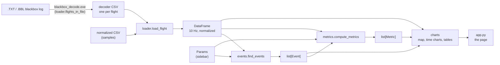
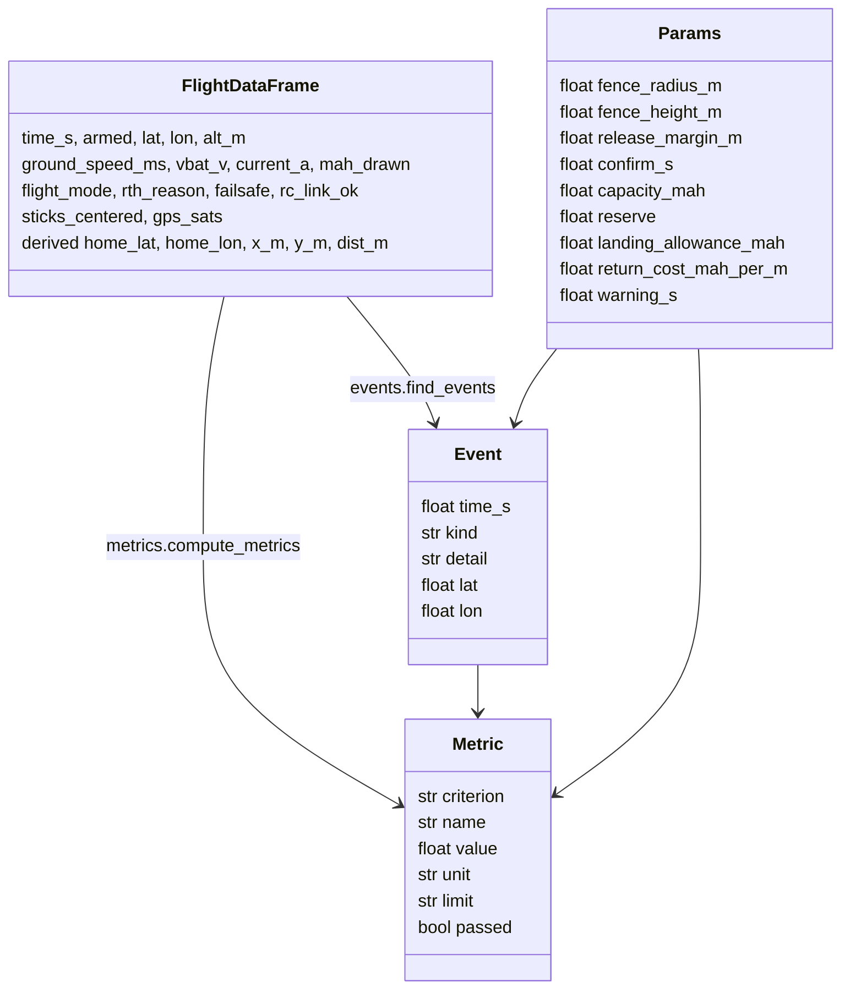

# ATMACA Flight Analyzer – Architecture

Input for the RAD. The requirements and the exact rules are in [CLAUDE.md](../CLAUDE.md); this document describes
how the program implements them.

## 1. Purpose

ATMACA is a GPS-assisted, safety-focused 6-inch FPV drone running INAV 9.1. Its safety functions (geofence with
release margin, distance-dependent battery RTH, failsafe RTH, position hold) must be shown to work. The analyzer is
a single local web page that reads one blackbox log, shows the flight, lists its events and checks the success
criteria SC-2 … SC-8 against limits from the RAD.

The most important design goal is that the code stays small, flat and obvious: every team member must be able to
explain any part and change it by hand during the final presentation. Therefore the program has no database, no
users, no classes except three dataclasses, and every constant lives in one file.

## 2. Data flow

Every user action (choosing a file, changing a parameter, moving the time cursor) makes Streamlit run `app.py`
again from top to bottom. Only the loading of a file is cached (`@st.cache_data`, keyed by path and modification
time) and a blackbox log is decoded only once (its folder in `logs/decoded/` is reused). Events, metrics and figures
are recomputed on every run; a flight has only about 6,000 rows, so this takes a fraction of a second.

## 3. Modules

There are no import cycles. In the order `models, config, geo, loader, metrics, events, charts, app` every module
imports only modules to its left.

| File | Responsibility | Public functions |
|---|---|---|
| `app.py` | The page: sidebar, cards, cursor, map, criteria table, charts, events, data section. Layout only, the only module that imports Streamlit. | `load_flight_cached`, `file_label`, `show_column_report` |
| `config.py` | All constants: paths, decoder settings, column map, mode rules, default parameters, success limits, analysis rules, colours and sizes. | – |
| `models.py` | The three dataclasses. | `Params`, `Event`, `Metric` |
| `loader.py` | File → normalized 10 Hz DataFrame; running the decoder; upload; column report. | `list_log_files`, `save_upload`, `flights_in_file`, `decode_blackbox`, `load_flight`, `find_home`, `nearest_row`, `normalize_decoder_csv`, `mode_from_flags`, `sticks_centered`, `column_report` |
| `geo.py` | Degrees ↔ metres around home (equirectangular), circle points. | `to_xy_m`, `circle_latlon`, `meters_per_deg_lon` |
| `events.py` | DataFrame → sorted list of events, one small detector per event kind; RTH reason inference. | `find_events`, `transitions`, `mode_changes`, `rth_starts`, `infer_rth_reason`, `limit_breaches`, `fence_releases` |
| `metrics.py` | DataFrame + events + Params → metric rows: summary cards, SC-2 … SC-8, measured return cost. | `compute_metrics`, `summary`, `battery_threshold`, `hover_segments`, `first_event`, `last_armed_row`, one function per criterion |
| `charts.py` | Plotly figures and display tables. | `map_figure`, `time_chart` and six chart functions, `criteria_table`, `events_table`, `result_style` |

Size (without tests, step 8): 975 lines; no module is longer than 220 lines (`metrics.py`: 219).

## 4. Data model

- **Params**: the safety parameters that were loaded on the drone for this flight. They are entered in the
  sidebar and start from `config.DEFAULT_PARAMS`. They are different from the **limits** (`SC…` constants in
  `config.py`), which are the project's fixed success criteria.
- **Event**: `kind` is one of ARM, DISARM, MODE, RTH_START, LINK_LOST, LINK_RESTORED, FAILSAFE_START,
  FAILSAFE_END, FENCE_BREACH, FENCE_RELEASE, ALTITUDE_BREACH.
- **Metric**: `value` and `passed` are `None` when the flight did not test the criterion (shown as N/A). A row
  with a value but without a limit is an information row (shown as INFO).
- **Normalized DataFrame**: one row every 0.1 s; the columns and units are listed in CLAUDE.md section 8.1.
  The loader adds `home_lat`/`home_lon` (kept in every row), `x_m`/`y_m` (metres east/north of home) and `dist_m`.

## 5. Events and metrics

The definitions are those of [CLAUDE.md section 10](../CLAUDE.md) (events) and
[section 11](../CLAUDE.md) (metrics). Implementation notes:

- A detector compares each row with the previous one, so an event gets the time of the **first row after** a
  change. The synthetic samples record the last row before the change, hence results such as the fence response
  can be 0.1 s longer than the ground truth (within the test tolerance of 0.15 s).
- FENCE_BREACH and ALTITUDE_BREACH are reported at first exceeding row + confirmation time.
- The RTH reason comes from the log's `rth_reason` column (synthetic samples) or is inferred in the order
  FAILSAFE → BATTERY → FENCE → PILOT and marked "(inferred)" (real INAV logs).
- SC-6: a confirmed breach that is not followed by a fence RTH fails the response row ("Fence response (no fence
  RTH)").
- The summary cards come from `metrics.summary()`; they are not part of `compute_metrics()` so that the criteria
  table does not repeat them.
- Result texts: PASS, FAIL, N/A (not tested) and INFO (information row).

## 6. External interfaces

| Interface | How it is used |
|---|---|
| INAV blackbox-tools 9.0.0 `blackbox_decode.exe` (GPL-3.0) | Run as a separate program with `subprocess.run` on a copy of the log in `logs/decoded/<log>/`, with `--merge-gps` (GPS fields, `GPS_home_lat` and `GPS_home_lon` in the main CSV; default units µs, V, A, cm, m/s and flag names). It writes `<log>.01.csv`, `<log>.02.csv` … (one per flight) next to its input. It exits with code 0 even when it finds no flight, so the loader checks whether CSV files were written. The binary is not committed (`tools/bin/` is ignored). |
| Decoder CSV headers | `config.COLUMN_MAP`: field name plus `" (unit)"` for converted fields, e.g. `time (us)`, `vbat (V)`, `amperage (A)`, `BaroAlt (cm)`, `flightModeFlags (flags)`, `GPS_speed (m/s)`. Taken from the decoder source, **unverified** until the first ATMACA bench log. |
| INAV flight-mode flags | `config.MODE_RULES`: `NAVRTH` → RTH, `NAVPOSHOLD` → EASY, `ANGLE` → NORMAL, none → SPORT (names as the decoder prints them; unverified). |
| OpenStreetMap tiles | Loaded by the browser through Plotly's map (`map_style="open-street-map"`); without internet the path is drawn on an empty background (`config.MAP_STYLE = "white-bg"`). |
| File system | `samples/` (synthetic flights, read only), `logs/` (real logs and uploads), `logs/decoded/` (decoder output, not committed). |

## 7. Test approach

- **pytest**, only through the public functions (the tests also show how to call them).
- `tests/test_metrics.py`: every value in `samples/*.truth.json` (hover drift, fence, battery RTH, failsafe,
  landing error, return cost) within the tolerances of CLAUDE.md section 13, PASS/FAIL cases and N/A cases. The
  tests use the fixed parameters the samples were generated with, not the sidebar defaults.
- `tests/test_events.py`: event times of `guest_fence` and `failsafe_rth`, the RTH reason inference with the
  reason column blanked out, the altitude breach.
- `tests/test_loader.py`: the samples load with all columns at 10 rows per second; `mode_from_flags`; resampling,
  mAh integration and conversions on the hand-written decoder CSV `tests/fixtures/decoder_flight.csv`; the
  messages for a missing decoder and for a file without flights (the latter runs the real decoder); upload; geometry.
- The 15 modification drills of CLAUDE.md section 15 were applied one by one to a copy of the project and checked on
  the page; they are documented in [MODIFICATION_GUIDE.md](MODIFICATION_GUIDE.md).
- Open item: when the first ATMACA bench log exists, verify `COLUMN_MAP`, `MODE_RULES` and `FAILSAFE_IDLE`, and
  replace the hand-written fixture by a cut of the real log.
