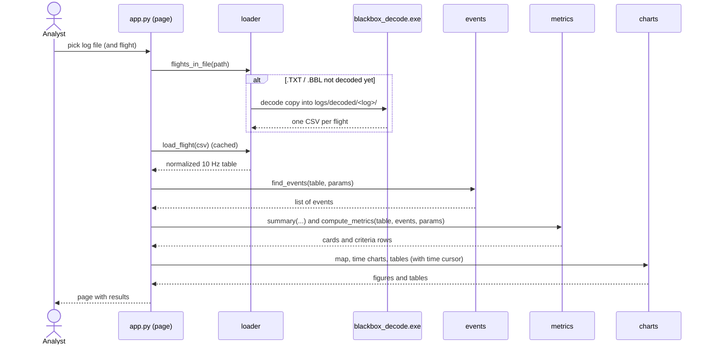

# RAD Brief – ATMACA Flight Analyzer

This file is for whoever writes or updates the **Requirements Analysis Document (RAD)** of the ATMACA project
(Işık University, COMP4902, Group 20), in particular an AI assistant. It describes the flight-log analyzer as it
is actually built (state: 2026-10-11, all build steps finished, verified with synthetic flights only). Use it as the
source of truth for everything about this program; do not invent features, numbers or results that are not here.

## 0. What to give the RAD writer

| File | Needed? | Why |
|---|---|---|
| `docs/RAD_BRIEF.md` (this file) | **required** | Scope, requirements, models, verification status, open items |
| `docs/ARCHITECTURE.md` | recommended | Data-flow and class diagrams (Mermaid), module table, external interfaces |
| `README.md` | recommended | User view of the page, terms and success-criteria tables |
| 2–3 screenshots of the page | recommended | For the user-interface section (a sample with map, criteria table and charts) |
| previous RAD | only when updating | So the writer can keep its structure and replace the outdated parts |
| `CLAUDE.md` | optional | Original detailed specification (exact column list, event and metric rules in sections 8–11). Sections 1 and 14 are instructions for the coding assistant, **not** requirements. |
| `config.py` | optional | Every default parameter, limit, threshold and colour with a comment |

The other source files, the tests and the sample CSV files are not needed for the RAD.

## 1. Context and scope

ATMACA is a GPS-assisted, safety-focused 6-inch FPV drone running **INAV 9.1**. Its safety functions are a geofence
(radius R, height H, release margin m), a distance-dependent battery return-to-home (RTH), a failsafe RTH on RC link
loss, and GPS position hold ("EASY" mode). The **ATMACA Flight Analyzer** is the ground-side program that reads the
drone's blackbox flight logs and checks whether these functions met the project's success criteria.

- It is one local web page (Python + Streamlit), started with `streamlit run app.py` on a team laptop.
- It is **deliberately small** (975 lines of code without tests): in the final presentation every team member must
  explain any part and make live changes requested by the jury.
- A larger ground station (ABP Framework, users, database, parameter sets, INAV script generation, test sessions)
  exists in **another repository**. It is **not** part of this program. If an older RAD describes those features as
  the ground software, move them out of this system's requirements (e.g. to "related systems / out of scope").

Explicit non-goals of the analyzer: login, users or roles; database (files only); parameter-set management; INAV
script generation; test-session management; comparison of several flights; PDF export; REST API; background jobs;
multi-page app.

## 2. Actors

| Actor | Role |
|---|---|
| Analyst (team member: Kaan, Umut, Ali) | Loads a log, sets the parameters that were on the drone, reads the results |
| Jury / reviewer | Watches the analysis; asks for live modifications of the program |
| Pilot | Flies the test and provides the blackbox log (indirect) |
| `blackbox_decode` (INAV blackbox-tools 9.0.0) | External program that turns a binary log into CSV files |
| OpenStreetMap tile service | Provides the background map in the browser |

## 3. Use cases

| ID | Use case | Main flow |
|---|---|---|
| UC-1 | Analyse a flight log | Analyst picks a file in the sidebar → (a blackbox log is decoded once) → if the file has several flights, picks the flight → the page shows summary, map, criteria, charts and events |
| UC-2 | Upload a log | Analyst uploads a `.TXT`, `.BBL` or `.csv` file in the sidebar → it is saved into `logs/` and appears in the file list |
| UC-3 | Ask "what if" | Analyst changes a safety parameter (e.g. R from 50 to 40 m) → events, criteria, circles and limit lines are recomputed immediately |
| UC-4 | Inspect a moment | Analyst moves the time cursor → a marker moves on the map and a vertical line on every chart |
| UC-5 | Diagnose a log that does not load | The page shows a clear message (decoder missing / no flight found / columns missing) and the column report (expected column, header in the file, found?) |
| UC-6 | Modify the program | A team member changes a limit, adds a chart, event, metric, card, etc. by hand (15 documented exercises, each ≤ 10 lines in ≤ 2 files) |

Example scenario (UC-1/UC-3): Umut opens `guest_fence.csv`. The criteria table shows SC-6 fence response 0.80 s
(PASS), horizontal overshoot 10.70 m (PASS); the events table lists FENCE_BREACH at 18.8 s, RTH_START (FENCE) at
19.6 s and FENCE_RELEASE at 28.1 s. He sets R to 40 m: the fence circle shrinks and FENCE_BREACH moves to 16.3 s.

## 4. Functional requirements (as implemented)

| ID | Requirement | Implemented in |
|---|---|---|
| FR-1 | List the flight files in `samples/` and `logs/` (`.csv`, `.txt`, `.bbl`) and let the user pick one | `loader.list_log_files`, `app.py` |
| FR-2 | Save an uploaded file into `logs/` | `loader.save_upload` |
| FR-3 | Decode an INAV blackbox log once with `blackbox_decode` into `logs/decoded/<log>/`, one CSV per flight (per arming); let the user pick the flight | `loader.flights_in_file`, `loader.decode_blackbox` |
| FR-4 | Convert every flight into a normalized table: one row every 0.1 s with time, armed, position, altitude, ground speed, voltage, current, consumed mAh, ATMACA flight mode, RTH reason, failsafe, RC link, sticks centred, satellites; plus distance from home | `loader.load_flight`, `loader.normalize_decoder_csv`, `geo` |
| FR-5 | Let the user enter the nine safety parameters loaded on the drone (R, H, m, confirmation time, C, r, L, k, warning time), starting from defaults, and recompute everything when one changes | `app.py`, `models.Params`, `config.DEFAULT_PARAMS` |
| FR-6 | Show summary cards: flight time, max distance, max altitude, mAh used, remaining %, min voltage, min satellites | `metrics.summary` |
| FR-7 | Show a map: path coloured by flight mode, home, touchdown, fence circle R, release circle R − m, one marker per event (hover text), time cursor | `charts.map_figure` |
| FR-8 | Show time charts: altitude (H, H − m), distance to home (R, R − m), ground speed, voltage, current, consumed mAh with the battery-RTH threshold T(d) | `charts.time_chart` and six chart functions |
| FR-9 | Provide a time cursor that moves a map marker and a vertical line on all charts | `app.py`, `charts` |
| FR-10 | Detect events: ARM, DISARM, MODE, RTH_START, LINK_LOST, LINK_RESTORED, FAILSAFE_START, FAILSAFE_END, FENCE_BREACH, FENCE_RELEASE, ALTITUDE_BREACH; list them with time and detail | `events.find_events` |
| FR-11 | Infer the RTH reason when the log has none (real INAV logs): FAILSAFE → BATTERY → FENCE → PILOT, marked "(inferred)" | `events.infer_rth_reason` |
| FR-12 | Evaluate the success criteria SC-2, SC-3, SC-4, SC-5, SC-6, SC-8 and the measured return cost k; show value, limit and PASS / FAIL / N/A / INFO with colours | `metrics.compute_metrics`, `charts.criteria_table` |
| FR-13 | Show a "Data" section with the first rows of the normalized data and the column report | `app.py`, `loader.column_report` |
| FR-14 | Show clear messages when the decoder is missing (what to download, where to put it), when a log contains no flight, or when expected columns are missing; the rest of the program keeps working for other files | `loader`, `app.py` |

## 5. Success criteria evaluated by the analyzer

Limits are fixed in the RAD and stored in `config.py`. "Parameters" (R, H, m, C …) are what was loaded on the drone
for one flight and can differ per flight; "limits" are the project's success criteria.

| Criterion | What is measured | Limit | N/A when |
|---|---|---|---|
| SC-2 hover | Longest hover (EASY, sticks centred, armed, ≥ 20 s); from 2 s after its start: horizontal drift from the hold point (RMS and max) and altitude error (RMS) | RMS ≤ 1.5 m, max ≤ 3 m, altitude RMS ≤ 1 m | no hover of ≥ 60 s |
| SC-3 RTH landing | Distance from home of the last armed row, if the flight ended in RTH | ≤ 3 m | no RTH landing |
| SC-4 failsafe | Time from RC link loss to the failsafe RTH; info: when the link and the pilot's control came back | ≤ 2 s | no link loss with failsafe RTH |
| SC-5 battery RTH | Used charge minus T(d) at the moment the battery warning started (RTH start − warning time); charge left after landing | \|error\| ≤ 50 mAh; ≥ 20 % of C | no battery RTH |
| SC-6 fence | Time from the confirmed breach (beyond R for the confirmation time) to the fence RTH — a breach without a fence RTH fails; overshoot beyond R and above H until the release (back in EASY inside R − m) | ≤ 1 s; ≤ 15 m horizontal, ≤ 5 m vertical | no confirmed breach |
| SC-8 endurance | Flight of ≥ 10 min: time in NORMAL or SPORT and charge left | 0 s; ≥ 20 % of C | flight shorter than 10 min |
| (info) return cost k | Charge per metre flown home between the end of the RTH climb and the start of the descent | – | no RTH with climb and descent |

Battery-RTH threshold: **T(d) = C·(1 − r) − L − k·d** (mAh), d = distance from home in metres.

SC-1 and SC-7 are **not** evaluated by the analyzer (they are not defined for log analysis in the specification).
The RAD writer should check in the RAD how they are verified (e.g. by inspection or bench test) instead.

## 6. Non-functional requirements (as implemented)

| ID | Category | Requirement and current state |
|---|---|---|
| NFR-1 | Maintainability (main goal) | Total ≤ 1,000 lines of code without tests (now 975); `app.py` ≤ 200, other modules ≤ 220 lines; functions ≤ 40 lines, nesting ≤ 3; one concept per file; every number, name and colour in `config.py`; plain functions, the only classes are three dataclasses |
| NFR-2 | Modifiability | 15 typical modifications (change a limit or default, add a chart, card, event, metric, CSV download, time range, …) each need ≤ 10 changed lines in ≤ 2 files; all 15 were applied to a copy and checked on the page (`docs/MODIFICATION_GUIDE.md`) |
| NFR-3 | Usability | One page in the browser, no login; every value with its unit; parameters with full names; limit lines labelled ("fence R = 50 m"); terms explained in README |
| NFR-4 | Performance | A flight has ~6,000 rows (10 Hz); a recomputation after a slider or parameter change took about 0.2 s (measured headless); a log is decoded once and a loaded flight is cached |
| NFR-5 | Correctness | 32 automated tests (pytest); every value in the synthetic ground-truth files is reproduced within fixed tolerances (section 9) |
| NFR-6 | Platform | Windows laptop (PowerShell), Python ≥ 3.12 (developed with 3.14.6); dependencies pinned: streamlit 1.65.0, pandas 3.0.6, plotly 7.1.0, pytest 9.1.1; runs offline except for the map tiles |
| NFR-7 | Robustness | A broken or unexpected log never crashes the page: the user gets a message and the column report |
| NFR-8 | Legal | `blackbox_decode` (GPL-3.0) is run as a separate program and not distributed with the code; map © OpenStreetMap contributors |

## 7. System models

### Object model

- **Params** – the nine safety parameters of one flight (R, H, m, confirmation time, C, r, L, k, warning time).
- **Event** – time, kind (one of the 11 kinds of FR-10), detail (e.g. new mode or RTH reason), position.
- **Metric** – criterion (e.g. "SC-6" or "" for information), name, value, unit, limit text, passed
  (True / False / None = not tested).
- **Flight data** (a table, not a class) – the normalized columns of FR-4 plus home position, east/north offset and
  distance to home.

Class and data-flow diagrams: `docs/ARCHITECTURE.md` sections 2 and 4.

### Dynamic model – UC-1 "Analyse a flight log"



Every user action (file, parameter, time cursor) runs the page again from top to bottom; only loading/decoding is
cached, so results always match the current parameters.

### User interface

```
+-- sidebar -----------------+  ATMACA Flight Analyzer – <file> · flight 1
| Upload a log               |  [Flight time] [Max distance] [Max altitude] [Used] [Remaining] [Min V] [Min sats]
| Log file      [v]          |  Time cursor ----o-------------------------------------------------
| Flight        [v] (if >1)  |  +------------- map --------------+  +---- success criteria -------------+
| Parameters on the drone    |  | path by mode, home, touchdown, |  | Criterion Metric Value Limit Result|
|  R – fence radius [m]      |  | circles R and R − m, events,   |  | SC-2 … SC-8, return cost k         |
|  H – fence height [m]      |  | time cursor                    |  | PASS green / FAIL red / N/A grey   |
|  m – release margin [m]    |  +--------------------------------+  +------------------------------------+
|  Breach confirmation [s]   |  [Altitude (H, H − m)]        [Distance to home (R, R − m)]
|  C, r, L, k, warning time  |  [Ground speed]               [Battery voltage]
+----------------------------+  [Current]                    [Consumed mAh and T(d)]
                                Events (time, event, detail) · ▸ Data (first rows, column report)
```

## 8. External interfaces

- **Input files**: normalized CSV (the synthetic samples; 15 named columns) or INAV blackbox `.TXT` / `.BBL`.
- **blackbox_decode 9.0.0** (INAV blackbox-tools): called with `--merge-gps`; writes `<log>.01.csv`, `<log>.02.csv` …;
  the column headers used are listed in `config.COLUMN_MAP` (e.g. `time (us)`, `vbat (V)`, `amperage (A)`,
  `navPos[2]`, `BaroAlt (cm)`, `flightModeFlags (flags)`, `failsafePhase (flags)`, `rxSignalReceived`,
  `GPS_coord[0]`, `GPS_speed (m/s)`, `GPS_home_lat`).
- **Flight modes** from INAV flags: NAVRTH → RTH, NAVPOSHOLD → EASY, ANGLE → NORMAL, none → SPORT (acro).
- **Consumed charge** is integrated from the current (mAh += A × s / 3.6), because INAV logs no mAh field.
- **Map tiles**: OpenStreetMap through Plotly (internet needed; otherwise an empty background).

## 9. Verification status

Only **synthetic flights** with known ground truth exist so far (generated by `tools/synthlog.py`); no real ATMACA
log has been analysed yet. Results with the sample parameters (R 50 m, H 30 m, m 15 m, confirmation 1 s,
C 3000 mAh, r 0.20, L 150 mAh, k 0.9 mAh/m, warning 5 s):

| Synthetic flight | Criterion | Analyzer | Ground truth | Test tolerance | Result |
|---|---|---|---|---|---|
| hover_before_tuning | SC-2 drift RMS / max / altitude RMS | 1.90 / 3.98 / 0.18 m | 1.9 / 3.98 / 0.18 m | 0.05 m | FAIL / FAIL / PASS |
| hover_after_tuning | SC-2 drift RMS / max / altitude RMS | 1.20 / 2.16 / 0.18 m | 1.2 / 2.16 / 0.18 m | 0.05 m | PASS / PASS / PASS |
| guest_fence | SC-6 response; overshoot horizontal / vertical; release | 0.80 s; 10.70 / 0.00 m; 28.1 s | 0.7 s; 10.7 / 0.0 m; 28.0 s | 0.15 s / 0.15 m | PASS; PASS / PASS |
| battery_rth | SC-5 threshold error; remaining; SC-3 landing; k | 13.8 mAh; 613 mAh; 2.00 m; 0.90 mAh/m | 13.1 mAh; 613 mAh; 2.0 m; 0.9 | 3 mAh; 0.15 m; 0.02 | PASS; PASS; PASS; info |
| failsafe_rth | SC-4 response; link restored; control regained | 0.50 s; 57.1 s; 57.9 s | 0.5 s; 57.0 s; 57.8 s | 0.15 / 0.15 / 0.25 s | PASS; info; info |

Notes for the RAD:
- Event-based times can be 0.1 s later than the ground truth: the analyzer reports the first row *after* a change,
  the generator recorded the last row *before* it (10 Hz resolution).
- With the default R = 50 m, `battery_rth` and `failsafe_rth` also show SC-6 FAIL (they fly 250–330 m from home and
  no fence RTH follows). This is correct behaviour: for such flights the fence parameters that were really loaded on
  the drone must be entered in the sidebar.
- The decoder path was tested with a hand-written decoder-format CSV and with the real `blackbox_decode.exe` on an
  invalid file (clear "no flight" message).

## 10. Decisions that differ from or extend the original specification

1. Result "INFO" in addition to PASS / FAIL / N/A, for information rows without a limit.
2. SC-6: a confirmed breach without a following fence RTH fails the response row ("Fence response (no fence RTH)").
3. The summary cards are computed separately (`metrics.summary`) and are not repeated in the criteria table.
4. The criteria and events tables are built in `charts.py`, so that `events.py` and `metrics.py` only compute.
5. The decoder column names and INAV flag names were taken from the blackbox-tools 9.0.0 source (e.g. `NAVRTH`, not
   `NAV_RTH`); still marked UNVERIFIED.
6. Home = `GPS_home_lat`/`GPS_home_lon` of the decoded log if present, otherwise the first GPS fix; it is kept in
   every row so that a part of the flight still knows home.
7. Developed and tested with Python 3.14 (the specification asked for 3.12 or newer).

## 11. Open items and limitations

- **Real-log verification** (first bench log expected around early November 2026): verify `config.COLUMN_MAP`,
  `config.MODE_RULES` and the failsafe idle text, check that `blackbox_decode` 9.0.0 decodes INAV 9.1 logs, and
  replace the hand-written test file by a cut of the real log.
- INAV logs no RTH reason; for real logs it is inferred and may be wrong in mixed situations (e.g. a fence RTH that
  starts while the used charge is already close to T(d) is reported as BATTERY, because the battery check comes
  before the fence check).
- No INAV flag maps to "LAND" yet; an RTH landing is shown as RTH (which is what SC-3 needs).
- Map tiles need internet.
- SC-1 and SC-7 are outside the analyzer (see section 5).

## 12. Guidance for the RAD writer

- Describe the analyzer with the terms above (R, H, m, R − m, T(d), C, r, L, k; EASY, NORMAL, SPORT, RTH, LAND;
  PASS / FAIL / N/A / INFO). The glossary in README.md can be copied.
- Keep requirement IDs (FR-, NFR-, UC-) or renumber them consistently; keep the traceability to modules and tests.
- Present the section 9 numbers as "verified against synthetic flights with known ground truth", never as real
  flight results.
- Keep everything marked UNVERIFIED or open marked as such.
- Ask the team for anything not covered here (drone hardware, INAV configuration, SC-1/SC-7 definitions, the RAD
  template of the course) instead of assuming it.
